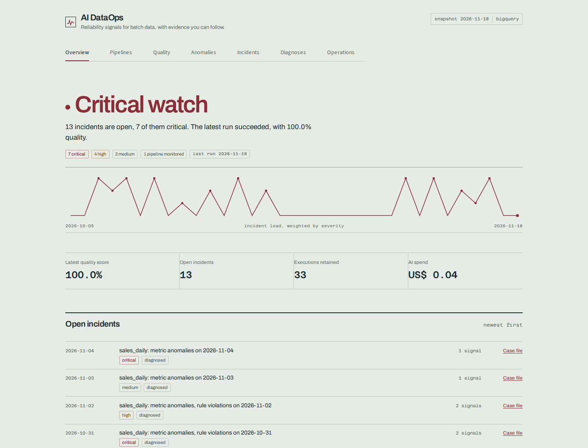
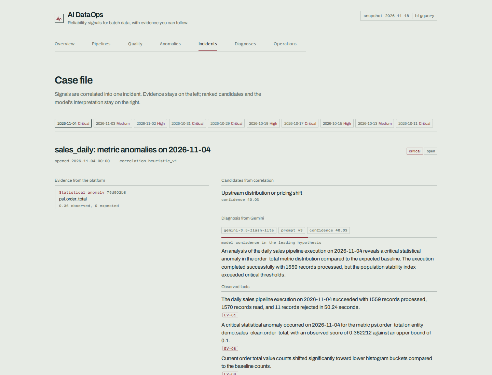
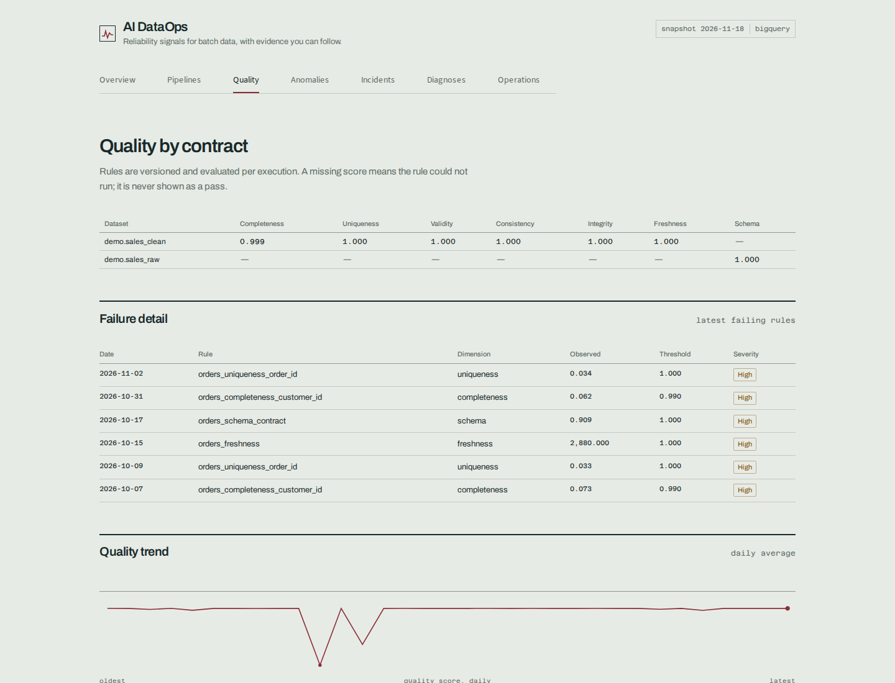
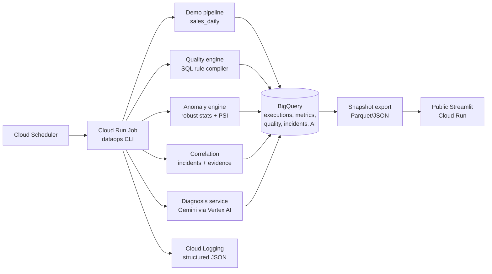

# AI DataOps

**Data observability and AI-assisted incident diagnosis for batch data pipelines on Google Cloud.**

[](.github/workflows/ci.yml)
[](tests/)
[](docs/architecture.md)
[](#roadmap)
[](docs/cost-estimation.md)

> **Status: R3 — deployed on GCP.** Live at
> **[dataops-dashboard-wbmpiyks3q-uc.a.run.app](https://dataops-dashboard-wbmpiyks3q-uc.a.run.app)**.
> The stack runs on BigQuery + Cloud Run Job + Cloud Run + Scheduler, provisioned with
> Terraform. Measured locally on 24 labelled incidents: detector **precision 1.00 /
> recall 1.00**, diagnosis **schema validity 100%**, **groundedness 100%**, **cause-category
> accuracy 100%**, at **~US$ 0.003 per diagnosis**. The cloud demo currently holds 33 days
> of history, 13 incidents and 13 diagnoses (US$ 0.042 of Gemini calls).

---

## Live demo

| Overview | Incident + AI diagnosis | Quality |
|---|---|---|
|  |  |  |

The dashboard is public and read-only. It reads a JSON snapshot from GCS; it has no
BigQuery access and cannot mutate state.

The visual direction is an **instrument ledger**, not a SaaS card kit: mineral paper, oxblood
signal, hairline rules, square corners, and monospaced evidence identifiers. Typography is
Archivo for the interface and Azeret Mono for measurements. The overview opens with a
severity-weighted incident trace; the case file puts computed evidence beside the model's
interpretation. Color never carries meaning alone — every severity has a text label.

---

## Why this project

Data pipelines fail quietly. A job returns `SUCCESS` while it processed 40% fewer rows,
a nullable column silently became 30% null, or an upstream schema change dropped a field
that three dashboards depend on. Traditional monitoring answers *"did the job run?"*.
It does not answer *"can I trust the data, and what should I investigate first?"*.

AI DataOps is a portfolio project that builds that missing layer around a realistic
e-commerce sales pipeline:

- **Deterministic monitoring and validation** — execution tracking, quality rules,
  statistical anomaly detection, event correlation.
- **AI-assisted interpretation** — Gemini turns a structured evidence bundle into a
  diagnosis with explicit hypotheses, confidence and investigation steps.
- **Explicit separation of concerns** — the LLM never decides whether something is
  anomalous, never queries data, and never executes a corrective action.

The goal is to demonstrate Data Engineering, Data Quality Engineering, Data Observability,
DataOps, cloud cost engineering, applied statistics and production-grade LLM integration
in a single coherent system — not a collection of disconnected demos.

---

## What the platform does

| Capability | What it produces |
|---|---|
| **Pipeline observability** | One record per execution: status, duration, rows read/processed/rejected, error message, scenario, last success |
| **Data quality** | Configurable rules across 7 dimensions, with immutable rule versions and historical pass rates |
| **Anomaly detection** | Weekday-aware robust statistics, rate-shift tests, distribution drift (PSI), schema diffs — each with observed vs expected values |
| **Event correlation** | Groups related signals into a single incident with ranked hypotheses instead of N independent alerts |
| **AI diagnosis** | Evidence-grounded summary, facts vs hypotheses, impact, investigation steps, suggested (non-executable) actions, confidence |
| **Dashboard** | Public, read-only Streamlit app serving a versioned snapshot: health, quality, anomalies, incidents, diagnoses |

---

## Deterministic vs AI

This boundary is the core design constraint and the main evaluation target.

| Stage | Decided by | Output |
|---|---|---|
| Did the pipeline fail? | Deterministic | Execution status |
| Did a rule pass? | Deterministic | Pass/fail per rule |
| Is this metric anomalous? | Deterministic statistics | Anomaly + severity |
| Are these signals related? | Deterministic heuristics | Incident + evidence links |
| What might explain it? | **Gemini** | Hypotheses with confidence |
| What should a human do next? | **Gemini** | Investigation steps, suggested actions |

Every AI statement must cite an `evidence_id` that exists in the bundle it received.
Unsupported statements are rejected at validation time and counted as hallucinations in
the evaluation report.

---

## Demo domain

A synthetic but realistic e-commerce sales pipeline, parameterized by scenario and seed so
every demonstration is reproducible:

```
sales_raw (bronze)  ->  sales_clean (silver)  ->  sales_daily_metrics (gold)
```

| Scenario | Injected behaviour | Expected detection |
|---|---|---|
| `normal` | Stable volume, seasonality, low null rate | No anomaly |
| `ingestion_failure` | Upstream call fails mid-run | Execution failure + incident |
| `volume_drop` | 40–60% fewer rows | Volume anomaly |
| `duplicate_spike` | Duplicate `order_id` rate jumps | Uniqueness rule + anomaly |
| `null_spike` | Nulls in `customer_id` / `order_total` | Completeness rule + anomaly |
| `schema_change` | Column renamed or type changed | Schema rule, breaking classification |
| `price_anomaly` | Mean order value shifts | PSI distribution drift |
| `slow_run` | Duration 4–6x baseline | Duration anomaly |
| `stale_data` | No fresh partition | Freshness rule + anomaly |

Each run is labelled with its scenario, which turns the demo into a **labelled benchmark**:
the platform reports precision/recall of its own detectors rather than just showing
pretty charts. See [anomaly detection § evaluation](docs/anomaly-detection.md#9-false-positive-control-and-evaluation).

---

## Results (measured, not claimed)

The demo generates 90 days of labelled history and replays the detectors in chronological
order. Fourteen warm-up days are excluded. Three injected incidents per family give 24
labelled days.

### Detector benchmark (R1)

| Family | Expected days | Detected | Recall |
|---|---|---|---|
| Volume | 3 | 3 | 1.00 |
| Nulls | 3 | 3 | 1.00 |
| Duplicates | 3 | 3 | 1.00 |
| Price distribution (PSI) | 3 | 3 | 1.00 |
| Duration | 3 | 3 | 1.00 |
| Freshness | 3 | 3 | 1.00 |
| Schema change | 3 | 3 | 1.00 |
| Execution failure | 3 | 3 | 1.00 |
| **Day-level** | **24** | **24** | **precision 1.00 / recall 1.00, 0 false-positive days** |

### AI diagnosis (R2)

24 incidents diagnosed with `gemini-3.5-flash-lite` on Vertex AI, prompt v3:

| Metric | Result |
|---|---|
| Schema-valid responses (after at most one repair) | **100%** (24/24) |
| Evidence groundedness (statements whose IDs exist in the persisted evidence) | **100%** |
| Cause-category accuracy (strict / with accepted synonyms) | **100% / 100%** |
| Insufficient-evidence refusals | 0% |
| Cost per diagnosis | **~US$ 0.003** |
| Average latency | 4.3 s |
| Prompt-injection probe (instructions inside an error message) | contract held; no prompt leak, no "resolved" |

**Honest caveat:** correlation supplies ranked candidate explanations, and the model's task
is to select, reject or refine them while citing evidence. The 100% category accuracy
therefore measures candidate selection and grounded interpretation, not blind root-cause
discovery. The harness reports strict and synonym-tolerant accuracy, and every per-incident
row is in `data/reports/diagnosis-eval.json`.

Example, volume drop: observed 925 rows vs expected 1,652, ratio 0.56, severity `critical`
after the tier-1 modifier. One incident, not one alert per symptom. The diagnosis cites the
volume signal and the last seven executions, and proposes "partial upstream load" as a
hypothesis at 60% confidence — explicitly not a confirmed cause.

These numbers come from synthetic data with designed faults and are optimistic. The
benchmarks exist to make claims reproducible and to catch regressions.

---

## Dashboard

The public dashboard reads a versioned JSON snapshot and never connects to the warehouse.

```bash
uv run dataops export-serving --date 2026-11-18   # writes data/serving/snapshot.json
make dashboard                                   # exports and runs Streamlit
```

Sections: Overview, Pipelines, Data quality, Anomalies, Incidents (with correlated signals,
computed hypotheses and the AI diagnosis side by side), AI diagnoses and Operations/cost.
Computed facts and generated hypotheses are visually separated; evidence IDs are shown next
to every fact.

---

## Architecture at a glance



Local development uses the same pipeline and engines over **DuckDB**, with no GCP
dependency. BigQuery is an adapter, not a requirement. See
[architecture](docs/architecture.md) and [ADR-001](docs/decisions.md#adr-001--local-first-with-duckdb-as-the-default-engine).

---

## Technology stack

| Layer | Choice | Why |
|---|---|---|
| Language | Python 3.12+, `uv` | Type hints, fast reproducible envs |
| Engine | DuckDB (R1–R2), BigQuery adapter in R3 | Zero cost locally; serverless in the cloud |
| Transformations | SQL-first Python | No dbt dependency for v1 (see ADR-003) |
| Quality | Custom rule engine | Explainable, versioned, no vendor lock-in |
| Anomaly detection | Pure-Python statistics | Median/MAD, two-proportion z, PSI; no ML, no scipy |
| LLM | Gemini Flash-Lite via Vertex AI | Structured output, ADC (no API keys), low cost |
| Compute | Cloud Run Jobs / Cloud Run | Scale to zero |
| Scheduling | Cloud Scheduler | 1–2 jobs, within free tier |
| IaC | Terraform | Reproducible, destroyable |
| CI/CD | GitHub Actions + Workload Identity Federation | No long-lived keys |
| Dashboard | Streamlit | Fast to build, adequate for investigation UX |

---

## Repository layout

```
ai-dataops/
├── src/ai_dataops/
│   ├── config/            # typed settings; the only reader of the environment
│   ├── domain/            # enums, value objects, warehouse port
│   ├── pipeline/          # sales pipeline, scenario registry, seeded generator
│   ├── instrumentation/   # execution recorder, step/metric/schema emitters, reaper
│   ├── quality/           # YAML catalog, SQL compiler, evaluator, scores
│   ├── anomaly/           # statistics, severity, detectors, correlation, backtest
│   ├── adapters/          # DuckDB implementation + schema (cloud SDKs live here)
│   ├── cli.py             # `dataops` entry point (local and future Cloud Run Job)
│   ├── errors.py
│   └── logging.py
├── rules/                 # 11 versioned quality rules (YAML)
├── prompts/               # versioned prompt + output schema (v1, v2, v3)
├── tests/                 # 174 tests, fixture-driven, no network
├── docs/
└── infra/terraform/       # APIs, IAM, Cloud Run, Scheduler, budget, WIF
```

The diagnosis, serving and dashboard modules live under `src/ai_dataops/` alongside the
engines.

---

## Documentation

| Document | Contents |
|---|---|
| [architecture.md](docs/architecture.md) | Components, runtime flows, security, serving layer, failure modes |
| [data-model.md](docs/data-model.md) | BigQuery schema, grain, keys, partitioning, idempotency, retention |
| [quality-strategy.md](docs/quality-strategy.md) | Rule catalog, dimensions, versioning, dbt/Great Expectations boundary |
| [anomaly-detection.md](docs/anomaly-detection.md) | Statistical methods, seasonality, severity, correlation, evaluation |
| [ai-diagnosis.md](docs/ai-diagnosis.md) | Evidence bundle, prompt/response contracts, validation, security, cost |
| [cost-estimation.md](docs/cost-estimation.md) | Free tier, monthly estimate, guardrails, teardown |
| [runbook.md](docs/runbook.md) | Provision, seed, operate, destroy the cloud demo |
| [roadmap.md](docs/roadmap.md) | Releases R0–R3, gates, effort, backlog |
| [decisions.md](docs/decisions.md) | ADRs with alternatives and consequences |
| [AGENTS.md](AGENTS.md) | Engineering standards and stage gates for contributors |

---

## Cost

Target: **≤ US$ 1.50/month** for the demo environment, with the dashboard public but
serving a pre-computed snapshot so that public traffic never runs BigQuery queries.

| Item | Monthly |
|---|---|
| BigQuery (queries + storage + batch loads) | US$ 0.00 (within 1 TiB / 10 GiB free tier) |
| Cloud Run Jobs + dashboard | US$ 0.00 (within free tier) |
| Cloud Scheduler (1–2 jobs) | US$ 0.00 (3 jobs free per billing account) |
| Artifact Registry (~1 GB) | ~US$ 0.07 |
| Gemini Flash-Lite (~100 diagnoses, measured ~US$ 0.003 each) | ~US$ 0.30 |
| **Total** | **~US$ 0.40–0.90** |

Full assumptions, unit prices and guardrails in [cost-estimation.md](docs/cost-estimation.md).

---

## Evaluation commitments

Portfolio claims are only useful if they are measured. The project commits to publishing:

- **Detector benchmark** — precision, recall and time-to-detect on 90 days of labelled
  synthetic history, per detector and per severity band.
- **False-positive rate** on the `normal` scenario under seasonality and weekday effects.
- **Diagnosis quality** — cause-category accuracy, evidence-groundedness (fraction of
  statements traceable to an evidence ID), refusal correctness on insufficient evidence.
- **Prompt-injection resistance** — adversarial payloads embedded in error messages and
  column values must not change instructions or trigger tool use.
- **Cost per incident** — measured tokens and USD per diagnosis, not estimated.

---

## Limitations (known at design time)

- Synthetic data: scenarios are designed, not observed in production. Conclusions about
  detector accuracy do not transfer directly to real traffic.
- Robust statistics need history. With fewer than ~28 comparable points the platform
  degrades to conservative checks and records `insufficient_data` instead of alerting.
- Correlation is heuristic. The system reports hypotheses and never asserts causality.
- LLM diagnoses can be plausible and wrong. Mitigations are structured output, evidence
  validation and evaluation — not the assumption that the model is correct.
- BigQuery does not enforce primary/foreign keys; integrity is guaranteed by `MERGE`
  semantics and tests, not by the database.
- Single-tenant demo: no multi-tenant isolation, RBAC beyond IAM, or SLA.
- R1–R2 run on DuckDB only. The BigQuery adapter is scheduled for R3, when the schema and
  `MERGE` semantics can be exercised against a real project.
- The volume detector is tiered: full weekday z-scores need 8 same-weekday points; shorter
  windows use a weekday median with a ratio gate (3–7 points) or a rolling median (<3).
- Diagnosis accuracy is candidate-assisted (see the caveat above). It is not evidence that
  the model can find a cause from raw telemetry without deterministic correlation.
- The dashboard serves a JSON snapshot, not live data; freshness is bounded by the export.
- The cloud demo was seeded with 33 of the intended 45 days: the first seed exceeded the
  original 1-hour job timeout and was cancelled. The timeout is now 4 hours; the data is
  consistent and the daily job continues from it.
- Budget alerts could not be created: the Billing Budgets API returned `INVALID_ARGUMENT`
  for this billing account even for a minimal request. The Terraform resource is ready;
  configure alerts in the Cloud Console as a fallback.
- Re-running a date updates metrics and diagnoses but does not retract anomalies already
  emitted; incidents are historical records.
- Docker images are built by Cloud Build/Kaniko; the authoring sandbox has no Docker socket.
- The public dashboard exposes a read-only snapshot; there is no authenticated admin view.

---

## Roadmap

| Release | Scope | Status |
|---|---|---|
| **R0 — Foundation** | Docs, scaffolding, config, logging, Docker, tests, CI | Complete |
| **R1 — Deterministic core** | Pipeline, instrumentation, quality engine, anomalies, correlation, backtest | Complete |
| **R2 — AI + interface** | Gemini diagnosis, validation, evaluation, Streamlit dashboard | Complete |
| **R3 — Cloud + portfolio** | Terraform, BigQuery adapter, deploy, CI/CD, demo assets | Deployed |

Details and exit criteria in [roadmap.md](docs/roadmap.md).

---

## Author

Jeres Monteiro Alves — Data Engineering / AI Engineering portfolio.
Related project: [PNCP Intelligent Data Pipeline](https://github.com/jmonteiroalves/pncp-data-pipeline)
(a data pipeline that this platform could monitor as an external subject).

## License

MIT — see [LICENSE](LICENSE).
