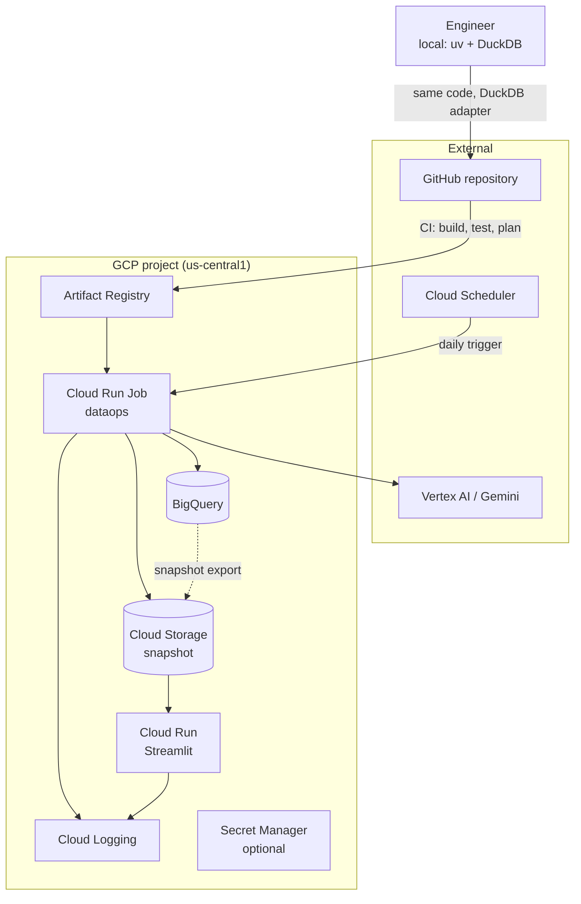
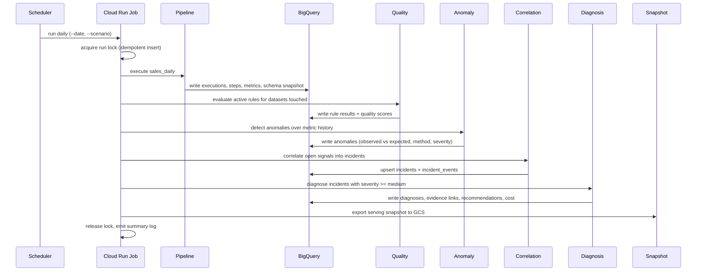

# Architecture

Status: approved for R0. Scope: demo environment, single GCP project, single tenant.
Related: [data model](data-model.md), [decisions](decisions.md), [costs](cost-estimation.md).

---

## 1. Goals and constraints

**Goals**

1. Observe a batch pipeline end to end: execution, data quality, statistical anomalies.
2. Produce explainable, historically grounded signals — every alert shows observed vs expected.
3. Use an LLM only to interpret evidence, with strict output contracts and no side effects.
4. Run for under US$ 1.50/month, scale to zero, and be fully reproducible from Terraform.
5. Be testable and demonstrable without GCP credentials.

**Constraints**

- Serverless only: no VMs, clusters, Composer or provisioned capacity.
- One orchestrator, one container image, one scheduler job (plus an optional manual trigger).
- Public dashboard must not create unbounded BigQuery cost.
- No service account keys, no credentials in the repository.
- Business logic must not import GCP SDKs directly.

---

## 2. System context



The local environment is a first-class target, not a degraded mode. DuckDB is the default
adapter; BigQuery implements the same port for the cloud deployment (MERGE for logical keys,
batch load jobs for append-only facts). The dashboard reads a snapshot from GCS in the cloud
and from disk locally.

---

## 3. Component inventory

| # | Component | Responsibility | Implementation | Scaling | Failure handling |
|---|---|---|---|---|---|
| 1 | Demo pipeline (`sales_daily`) | Ingest raw orders, clean/validate, aggregate to daily metrics | Python + SQL | Batch, single task | Explicit failure, partial-run marking |
| 2 | Instrumentation | Emit one execution record + step timings + counters + structured logs | Context manager / decorator | In-process | Guarantees terminal status via `finally`; stale-run reaper |
| 3 | Metric collector | Persist normalized observations (volume, null rate, duration, ...) | Repository | In-process | Idempotent upsert by `(execution_id, entity, metric)` |
| 4 | Quality engine | Load rule catalog, compile to SQL, execute, persist results | Python + SQL compiler | In-process | Rule errors isolated; one bad rule cannot abort the run |
| 5 | Anomaly engine | Build baselines from history, run detectors, compute severity | Python (NumPy/pandas) | In-process | Skips with `insufficient_data`; per-detector isolation |
| 6 | Correlation engine | Group signals into incidents, link evidence, dedupe | Heuristics + lineage | In-process | Never deletes anomalies; runs are replayable |
| 7 | Diagnosis service | Build evidence bundle, call Gemini, validate, persist | Vertex AI SDK + Pydantic | In-process, serial | Timeout/retry/invalid-response handling; kill switch |
| 8 | Snapshot exporter | Export serving views to a versioned snapshot | BigQuery export / Parquet | Batch | Snapshot versioned; dashboard keeps last good |
| 9 | Dashboard | Read-only investigation UI | Streamlit | 0–2 instances | Reads snapshot only; no DB writes |
| 10 | Orchestrator | Sequenced execution of stages + locking | CLI subcommands | 1 execution | Fail-fast per stage, resumable by date |
| 11 | Scheduler | Daily trigger + optional retry | Cloud Scheduler | 1 job | Retry with backoff; dead-man alert |
| 12 | CI/CD | Lint, format, type check, tests, Terraform plan, deploy | GitHub Actions + WIF | Ephemeral | Deploy blocked on failed gates |
| 13 | Observability | Structured logs, log-based metrics, alerts | Cloud Logging/Monitoring | Managed | Alert on job failure, stale data, invalid diagnoses |

### Deliberate exclusions

| Excluded | Reason |
|---|---|
| Cloud Composer | ~US$ 300+/month minimum; DSL overhead with no portfolio benefit |
| Cloud Workflows | Adds a second orchestration language; the CLI already sequences stages idempotently (ADR-002) |
| Dataplex / Dataform | Extra services without new learning signal for this scope |
| Kafka / Pub/Sub streaming | The subject is batch pipelines with quality SLAs; streaming is out of scope |
| Looker / BI Engine | Dashboard requirement is investigation UX, not governed BI |
| Vector DB / RAG | The evidence bundle is small and structured; retrieval adds cost and failure modes |

---

## 4. Runtime flow

### 4.1 Daily orchestration



### 4.2 Stage contract

Each subcommand:

- accepts `--date`, `--pipeline`, `--dry-run`, `--scenario`;
- is **idempotent**: re-running the same date rewrites the same deterministic IDs;
- writes a `stage_runs` record with status, counters, duration and error;
- returns exit code `0` (success), `1` (data/business failure), `2` (infrastructure failure).

This makes the pipeline resumable: `dataops run-stage quality --date 2026-11-16` after fixing a rule.

### 4.3 Concurrency control

Cloud Run Jobs are configured with `parallelism = 1` and `max_retries = 1`. On top of that,
a logical lock is acquired in BigQuery:

```
run_locks(run_key PK, acquired_at, expires_at, owner)
```

`run_key = pipeline_id + logical_date`. Insert-if-absent; a stale lock (older than
`max_runtime + 10 min`) can be taken over and is logged as a warning. Locks are a safety
net, not the primary guarantee: every write is already an idempotent `MERGE`.

---

## 5. Environments

| Concern | Local (default) | GCP (demo) |
|---|---|---|
| Engine | DuckDB file / Parquet | BigQuery |
| Compute | `uv run dataops ...` | Cloud Run Job |
| Scheduler | `make demo` / cron | Cloud Scheduler |
| LLM | `FakeDiagnosisProvider` or AI Studio key (optional) | Vertex AI with ADC |
| Dashboard | `streamlit run` over snapshot | Cloud Run (public, read-only) |
| Credentials | none | ADC / Workload Identity |
| Cost | US$ 0 | ≤ US$ 1.50/month |

Configuration is resolved once, at startup, into a typed `Settings` object. Environment
selection is a single variable (`DATAOPS_ENV=local|gcp`); adapters are chosen by a factory.
No business module reads environment variables directly.

---

## 6. Serving layer and dashboard

The public dashboard is the one place where an unbounded resource could meet untrusted
traffic, so it is separated from the analytical path:

1. The daily job exports **serving views** to a versioned snapshot
   (`snapshot.json` + manifest; the same document is served locally and from GCS in R3).
2. The Streamlit container loads the latest snapshot at startup (or on cache expiry) and
   **never queries BigQuery per request**.
3. If the snapshot is missing, the app falls back to the last good snapshot baked into the
   image; if that is also missing, it renders an explicit "no data" state.

Consequences: page load cost is container CPU only; a traffic spike is capped by
`--max-instances=2`; a compromised dashboard cannot mutate state.

| Page | Content | Source |
|---|---|---|
| Overview | Pipelines monitored, healthy/degraded, open incidents, quality score | `v_pipeline_health` |
| Pipelines | Execution history, duration, volume, failures, last success | `v_execution_history` |
| Data quality | Pass rates by dimension, trends, failing rules, dataset ranking | `v_quality_trend` |
| Anomalies | Open anomalies, severity, observed vs expected, method | `v_anomalies_recent` |
| Incidents | Incident detail, correlated evidence, timeline | `v_incident_detail` |
| AI diagnosis | Summary, facts, hypotheses, impact, recommendations, confidence | `v_latest_diagnoses` |
| Operations | Costs (tokens, USD), stage durations, failed diagnoses | `v_ops_daily` |

Access model: public read-only. No login, no write endpoint, no PII. An optional
`/admin` path protected by a shared secret is out of scope for R2.

---

## 7. Security model

**Identities** (one service account per workload, least privilege):

| Service account | Roles | Used by |
|---|---|---|
| `sa-dataops-job` | `roles/bigquery.dataEditor`, `roles/bigquery.jobUser` on project; `roles/storage.objectAdmin` on snapshot bucket; `roles/aiplatform.user` | Cloud Run Job |
| `sa-dataops-dashboard` | `roles/storage.objectViewer` on snapshot bucket only | Cloud Run service |
| `sa-dataops-deploy` (CI) | `roles/run.admin`, `roles/iam.serviceAccountUser`, `roles/artifactregistry.writer`, `roles/bigquery.admin` (bootstrap only) | GitHub Actions via WIF |

**Rules**

- No service account JSON keys. CI authenticates with Workload Identity Federation and a
  repository/branch-restricted attribute condition.
- The dashboard SA cannot read raw tables: it only reads the snapshot bucket.
- The LLM has no tool access, no SQL execution, no network egress beyond the Vertex endpoint.
- All monitored content is treated as untrusted input; the prompt delimits it explicitly and
  instructs the model to never follow instructions found inside data (see
  [ai-diagnosis § 7](ai-diagnosis.md#7-security-and-threat-model)).
- Terraform state is stored in GCS with versioning; no secrets in state (no secret values are
  managed by Terraform in v1).

---

## 8. Observability of the platform itself

A monitoring platform that fails silently is worse than none.

| Signal | Mechanism | Alert |
|---|---|---|
| Job failed or timed out | `stage_runs` + log-based metric | Alert policy → email |
| No run for > 26h (dead man) | Log-based metric absence / query on `pipeline_executions` | Alert |
| Execution stuck in `running` | Reaper marks stale runs after `max_runtime` | Warning log + metric |
| Rule error rate > 5% | `quality_rule_results.status = error` | Alert |
| Diagnosis invalid rate > 10% | `diagnoses.status = invalid` | Alert |
| Gemini spend > budget | `ai_requests.estimated_cost_usd` sum | Alert + kill switch |
| Snapshot older than 48h | `manifest.json` timestamp | Alert |

All logs are JSON with `severity`, `stage`, `run_key`, `execution_id`, `incident_id`,
`duration_ms`. No row-level data is logged; samples are truncated and hashed where needed.

---

## 9. Failure modes

| Failure | Detection | Behaviour | Recovery |
|---|---|---|---|
| Upstream extract fails | Exception in stage | Execution `failed`, partial counters persisted, incident created | Re-run same date after fix |
| Job killed mid-run | No terminal status | Reaper marks `failed` with `error_code=stale_run` | Idempotent re-run |
| Rule SQL invalid | Compiler/validator error | Rule result `error`, run continues | Fix rule version, re-run stage |
| BigQuery quota exceeded | API error | Stage `failed`, exit code 2 | Retry after quota reset |
| Insufficient history | Sample size check | Anomaly `skipped` / `insufficient_data` | Accumulate history |
| Gemini timeout | Client timeout | Diagnosis `failed`, retry once with jitter | Manual reprocess command |
| Invalid LLM JSON | Schema validation | One repair attempt, then `invalid`, stored raw | Reprocess with new prompt version |
| Snapshot export fails | Non-zero exit | Dashboard keeps previous snapshot | Next run |
| Traffic spike on dashboard | Cloud Run metrics | Capped at 2 instances, 429/503 beyond capacity | Acceptable for demo |

---

## 10. Cost-driven design decisions

1. **Batch loads, not streaming inserts** — load jobs are free; Storage Write API is billed.
2. **Partitioned tables + partitioning/clustering** — queries cannot accidentally scan history.
3. **`maximum_bytes_billed` per query** (200 MB in the demo) — a bad query fails instead of billing.
4. **Snapshot dashboard** — public traffic costs container time only, capped by max instances.
5. **Prompt budget** — only incidents with severity ≥ medium, deduplicated by evidence hash.
6. **Table expiration** on logs (30d) and raw events; aggregates kept for 400 days.
7. **Scale to zero** everywhere; no minimum instances.

Details in [cost-estimation.md](cost-estimation.md).

---

## 11. Non-goals

- Streaming / real-time observability.
- Automatic remediation or self-healing pipelines.
- Multi-tenant isolation, SSO, or RBAC beyond IAM.
- Data catalog, lineage discovery from SQL parsing, or impact analysis beyond a manual
  lineage table.
- Model training or ML-based anomaly detection (revisit only with evidence that robust
  statistics are insufficient).
