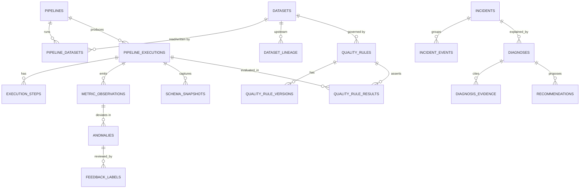

# Data model

Status: approved for R0. Target: BigQuery (`us-central1`); the DuckDB adapter implements the
same tables and column names. All timestamps are UTC `TIMESTAMP`.

---

## 1. Principles

1. **BigQuery has no enforced primary or foreign keys.** Every key below is *logical*. It is
   enforced by (a) `MERGE` on the natural/deterministic key, (b) uniqueness and relationship
   tests in CI and in the platform's own test suite, and (c) repository code with one write
   path per table. No component relies on the database to reject duplicates.
2. **Deterministic identifiers.** IDs are UUIDv5 values derived from natural keys, never
   random per attempt. Re-running a date reproduces the same IDs and updates the same rows.
3. **Append-only history, current-state views.** Execution facts, rule results and anomalies
   are append-only. Status changes are recorded as history rows; "current" is a view.
4. **One write path.** Each table has exactly one owning module. Cross-module updates go
   through the owning repository.
5. **Cost-shaped layout.** Large tables are partitioned by date, clustered by entity, and
   have `require_partition_filter = true`.
6. **No PII.** The demo dataset is synthetic. Log and sample fields are truncated and never
   contain row payloads.

---

## 2. Datasets and naming

| Dataset | Purpose | Owner module |
|---|---|---|
| `dataops_meta` | Configuration: pipelines, datasets, lineage, rules, prompts, models | `domain` / `quality` |
| `dataops_obs` | Execution and metric observations | `instrumentation` |
| `dataops_quality` | Rule results and aggregated quality scores | `quality` |
| `dataops_detect` | Anomalies, incidents, correlations, feedback labels | `anomaly` |
| `dataops_ai` | Diagnoses, evidence links, requests, recommendations | `diagnosis` |
| `dataops_serving` | Views and snapshot exports for the dashboard | `dashboard` |

Naming: `<domain>_<entity>` (plural for catalogs, singular for facts), snake_case,
`_id` for identifiers, `_at` for timestamps, `_date` for logical dates,
`_rate`/`_pct` for proportions in `[0,1]`, `_usd` for money.

---

## 3. Entity relationships



---

## 4. Table catalog

### 4.1 `dataops_meta`

| Table | Grain | Logical key | Retention |
|---|---|---|---|
| `pipelines` | one row per pipeline | `pipeline_id` | permanent |
| `datasets` | one row per monitored table | `dataset_key` | permanent |
| `pipeline_datasets` | pipeline × dataset × role | (`pipeline_id`,`dataset_key`,`role`) | permanent |
| `dataset_lineage` | one directed edge | `edge_id` | versioned (`valid_from`/`valid_to`) |
| `quality_rules` | one row per rule (current pointer) | `rule_id` | permanent |
| `quality_rule_versions` | one row per immutable version | (`rule_id`,`version`) | permanent |
| `scenarios` | one row per demo scenario | `scenario_id` | permanent |
| `prompt_versions` | one row per prompt/model/schema combination | (`prompt_id`,`version`) | permanent |
| `llm_models` | one row per priced model | (`model_id`,`valid_from`) | permanent |
| `run_locks` | one row per in-flight logical run | `run_key` | 7 days |

**`pipelines`**

| Column | Type | Notes |
|---|---|---|
| `pipeline_id` | STRING | slug, e.g. `sales_daily` |
| `name` | STRING | display name |
| `domain` | STRING | `sales` |
| `owner` | STRING | team/person |
| `criticality` | STRING | `tier_1`/`tier_2`/`tier_3` — feeds severity |
| `schedule_cron` | STRING | informational (Scheduler is the source of truth) |
| `expected_runtime_seconds` | INT64 | SLA baseline |
| `freshness_sla_minutes` | INT64 | e.g. 1560 (26h) |
| `is_active` | BOOL | soft delete |
| `created_at` / `updated_at` | TIMESTAMP | audit |

**`datasets`**

| Column | Type | Notes |
|---|---|---|
| `dataset_key` | STRING | `project.dataset.table`, stable |
| `layer` | STRING | `bronze`/`silver`/`gold` |
| `domain` | STRING | |
| `owner` | STRING | |
| `criticality` | STRING | `tier_1`/`tier_2`/`tier_3` |
| `freshness_sla_minutes` | INT64 | |
| `row_identifier` | STRING | business key column, e.g. `order_id` |
| `is_active` | BOOL | |
| `created_at` / `updated_at` | TIMESTAMP | |

**`quality_rules` / `quality_rule_versions`**

`quality_rules` holds the identity and the pointer to the active version;
`quality_rule_versions` is immutable and is what execution reads. Changing a rule means
inserting a new version and flipping `current_version`. See
[quality-strategy](quality-strategy.md#6-versioning).

| Column (`quality_rules`) | Type | Notes |
|---|---|---|
| `rule_id` | STRING | natural id, e.g. `orders_completeness_customer_id` |
| `name` | STRING | human label |
| `dataset_key` | STRING | FK → `datasets` |
| `dimension` | STRING | 7 allowed values |
| `current_version` | INT64 | FK → `quality_rule_versions.version` |
| `severity` | STRING | `info`..`critical` |
| `owner` | STRING | |
| `is_active` | BOOL | |
| `created_at` / `updated_at` | TIMESTAMP | |

| Column (`quality_rule_versions`) | Type | Notes |
|---|---|---|
| `rule_id` | STRING | part of PK |
| `version` | INT64 | monotonic per rule |
| `rule_type` | STRING | see quality-strategy § 4 |
| `columns` | ARRAY<STRING> | 1..n |
| `config` | JSON | type-specific parameters |
| `config_hash` | STRING | sha256 of canonical JSON |
| `threshold` | FLOAT64 | nullable; pass condition varies by type |
| `severity` | STRING | snapshot of severity at that version |
| `change_reason` | STRING | required |
| `created_by` | STRING | |
| `valid_from` | TIMESTAMP | |
| `valid_to` | TIMESTAMP | null = current |

**`prompt_versions`**

| Column | Type | Notes |
|---|---|---|
| `prompt_id` | STRING | e.g. `incident_diagnosis` |
| `version` | INT64 | |
| `model_id` | STRING | FK → `llm_models` |
| `system_instructions` | STRING | rendered text |
| `template` | STRING | user template with slot placeholders |
| `output_schema_version` | STRING | e.g. `diagnosis.v1` |
| `content_hash` | STRING | sha256; used for reproducibility |
| `is_active` | BOOL | exactly one active per prompt_id |
| `created_at` | TIMESTAMP | |

---

### 4.2 `dataops_obs`

| Table | Grain | Logical key | Partition | Cluster | Retention |
|---|---|---|---|---|---|
| `pipeline_executions` | one per pipeline × logical date × attempt | `execution_id`; unique (`pipeline_id`,`logical_date`,`attempt`) | `DATE(started_at)` | `pipeline_id` | 400 d |
| `execution_steps` | one per step per execution | (`execution_id`,`step_name`) | `DATE(started_at)` | `pipeline_id` | 180 d |
| `execution_log_events` | one per event | `event_id` | `DATE(event_at)` | `execution_id` | 30 d |
| `schema_snapshots` | one per column per capture | `snapshot_id` | `DATE(captured_at)` | `dataset_key` | 400 d |
| `metric_observations` | one per entity × metric per execution | `observation_id` | `DATE(observed_at)` | `entity_id`,`metric_name` | 400 d |
| `stage_runs` | one per stage per run | `stage_run_id` | `DATE(started_at)` | `stage_name` | 180 d |

**`pipeline_executions`** — the primary operational fact.

| Column | Type | Notes |
|---|---|---|
| `execution_id` | STRING | UUIDv5(`pipeline_id:logical_date:attempt`) |
| `pipeline_id` | STRING | FK → `pipelines` |
| `logical_date` | DATE | business date processed |
| `attempt` | INT64 | starts at 1 |
| `scenario_id` | STRING | nullable; demo ground truth |
| `status` | STRING | `running`/`succeeded`/`failed`/`skipped` |
| `started_at` / `finished_at` | TIMESTAMP | `finished_at` null while running |
| `duration_seconds` | FLOAT64 | derived; null while running |
| `records_read` | INT64 | |
| `records_processed` | INT64 | |
| `records_rejected` | INT64 | |
| `rejection_rate` | FLOAT64 | derived, `[0,1]` |
| `error_code` | STRING | stable code, e.g. `EXTRACT_TIMEOUT` |
| `error_message` | STRING | truncated to 2 KB, untrusted content |
| `triggered_by` | STRING | `scheduler`/`manual`/`backfill` |
| `execution_metadata` | JSON | git sha, image tag, params |
| `created_at` | TIMESTAMP | |

Derived invariants asserted by tests: `records_processed + records_rejected <= records_read`;
`status='succeeded'` implies `error_code IS NULL`; `finished_at >= started_at`.

**`metric_observations`** — the unified long table that feeds every detector.

| Column | Type | Notes |
|---|---|---|
| `observation_id` | STRING | UUIDv5(`entity_type:entity_id:metric:execution_id`) |
| `entity_type` | STRING | `pipeline`/`dataset`/`column` |
| `entity_id` | STRING | `pipeline_id`, `dataset_key`, or `dataset_key.column` |
| `metric_name` | STRING | controlled vocabulary below |
| `value` | FLOAT64 | numeric value |
| `unit` | STRING | `count`/`ratio`/`seconds`/`minutes`/`currency` |
| `execution_id` | STRING | FK → `pipeline_executions` |
| `observed_at` | TIMESTAMP | event time |
| `dimensions` | JSON | weekday, layer, scenario, method-specific tags |
| `is_valid` | BOOL | false when the observation is structurally unusable |

Metric vocabulary (v1):

| Metric | Entity | Unit | Source |
|---|---|---|---|
| `records_processed` | pipeline | count | instrumentation |
| `records_rejected` | pipeline | count | instrumentation |
| `rejection_rate` | pipeline | ratio | derived |
| `duration_seconds` | pipeline | seconds | instrumentation |
| `row_count` | dataset | count | quality/collector |
| `null_rate.<column>` | column | ratio | collector |
| `duplicate_rate` | dataset | ratio | collector |
| `freshness_lag_minutes` | dataset | minutes | collector |
| `mean.<column>` / `median.<column>` | column | currency | collector |
| `psi.<column>` | column | ratio | anomaly engine |
| `schema_column_count` | dataset | count | schema snapshot |
| `failure_streak` | pipeline | count | anomaly engine |

Metric names are ASCII, lowercase and stable. Adding one requires a migration note and a
detector mapping (or an explicit "no detector" entry).

**`schema_snapshots`**

| Column | Type | Notes |
|---|---|---|
| `snapshot_id` | STRING | UUIDv5(`dataset_key:captured_at:column`) |
| `dataset_key` | STRING | |
| `execution_id` | STRING | nullable for ad-hoc captures |
| `captured_at` | TIMESTAMP | |
| `column_name` | STRING | |
| `data_type` | STRING | BigQuery type |
| `is_nullable` | BOOL | |
| `ordinal_position` | INT64 | |
| `schema_hash` | STRING | hash of the full ordered schema |

---

### 4.3 `dataops_quality`

**`quality_rule_results`**

| Column | Type | Notes |
|---|---|---|
| `result_id` | STRING | UUIDv5(`rule_id:rule_version:execution_id`) |
| `execution_id` | STRING | FK → `pipeline_executions` |
| `rule_id` / `rule_version` | STRING / INT64 | FK → rule version |
| `dataset_key` | STRING | denormalized for query pruning |
| `evaluated_at` | TIMESTAMP | |
| `status` | STRING | `pass`/`warn`/`fail`/`error`/`skipped`/`insufficient_data` |
| `records_evaluated` | INT64 | |
| `records_passed` | INT64 | |
| `records_failed` | INT64 | |
| `pass_rate` | FLOAT64 | `passed / evaluated` |
| `observed_value` | FLOAT64 | e.g. null rate, duplicate count |
| `threshold` | FLOAT64 | snapshot of the rule threshold |
| `severity` | STRING | snapshot |
| `details` | JSON | up to 20 sample keys/values, truncated |
| `duration_ms` | INT64 | |
| `created_at` | TIMESTAMP | |

Partitioned by `DATE(evaluated_at)`, clustered by `dataset_key`, `rule_id`. Retention 400 d.
`details` never contains full rows.

**`quality_scores`** — one row per dataset × dimension × execution.

| Column | Type | Notes |
|---|---|---|
| `score_id` | STRING | UUIDv5(`dataset_key:dimension:execution_id`) |
| `execution_id` | STRING | |
| `dataset_key` | STRING | |
| `dimension` | STRING | 7 dimensions |
| `rules_total` / `rules_passed` / `rules_failed` / `rules_error` | INT64 | |
| `score` | FLOAT64 | weighted pass rate, `[0,1]` |
| `weight_total` | FLOAT64 | sum of rule weights |
| `created_at` | TIMESTAMP | |

Dataset-level score = weighted average across dimensions; weights live in the rule catalog.
A dimension with only `error`/`skipped` results is reported as `null`, never as 1.0.

---

### 4.4 `dataops_detect` — anomalies and incidents

**`anomalies`**

| Column | Type | Notes |
|---|---|---|
| `anomaly_id` | STRING | UUIDv5(`entity:metric:bucket:method:version`) |
| `entity_type` / `entity_id` | STRING | |
| `metric_name` | STRING | |
| `execution_id` | STRING | nullable for time-based detectors |
| `detected_at` | TIMESTAMP | |
| `window_start` / `window_end` | TIMESTAMP | evaluation window |
| `observed_value` | FLOAT64 | |
| `expected_value` | FLOAT64 | baseline (median or rate) |
| `lower_bound` / `upper_bound` | FLOAT64 | decision bounds |
| `deviation_abs` | FLOAT64 | observed − expected |
| `deviation_pct` | FLOAT64 | (observed − expected) / expected |
| `score` | FLOAT64 | robust z or PSI, method-specific |
| `method` / `method_version` | STRING | e.g. `robust_z_weekday` / `1.0` |
| `sample_size` | INT64 | history points used |
| `severity` | STRING | `info`..`critical` |
| `confidence` | FLOAT64 | `[0,1]`, derived from sample size and effect |
| `signal_type` | STRING | `statistical_anomaly`/`rule_violation`/`schema_change`/`operational_failure` |
| `status` | STRING | `open`/`confirmed`/`false_positive`/`ignored`/`resolved` |
| `explanation` | JSON | method parameters, baseline window, thresholds |
| `created_at` | TIMESTAMP | |

Partitioned by `DATE(detected_at)`, clustered by `entity_id`, `metric_name`. Retention 400 d.
`anomaly_id` includes a time bucket (e.g. 6h) so the same deviation is not re-inserted on
every replay.

**`incidents`**

| Column | Type | Notes |
|---|---|---|
| `incident_id` | STRING | UUIDv5(`signature:bucket_start`) |
| `signature` | STRING | hash of sorted signal types + primary entity |
| `bucket_start` | TIMESTAMP | 6-hour correlation bucket |
| `title` | STRING | deterministic, generated from signals |
| `primary_pipeline_id` / `primary_dataset_key` | STRING | |
| `severity` | STRING | max of linked signals, then adjusted |
| `status` | STRING | `open`/`investigating`/`mitigated`/`resolved` |
| `opened_at` / `closed_at` | TIMESTAMP | |
| `evidence_count` | INT64 | maintained on link/unlink |
| `has_diagnosis` | BOOL | |
| `correlation_method` | STRING | `heuristic_v1` |
| `hypotheses_json` | JSON | ranked candidate explanations with evidence ids (never asserted as cause) |
| `created_at` / `updated_at` | TIMESTAMP | |

**`incident_events`**

| Column | Type | Notes |
|---|---|---|
| `incident_id` | STRING | |
| `event_type` | STRING | `execution_failure`/`rule_violation`/`anomaly`/`schema_change` |
| `event_ref_id` | STRING | id in the source table |
| `linked_at` | TIMESTAMP | |
| `weight` | FLOAT64 | strength of the association |
| `evidence` | JSON | what justified the link (time delta, lineage path, shared entity) |

Logical key (`incident_id`,`event_type`,`event_ref_id`) — dedupes relinking.

**`incident_status_history`** — `history_id`, `incident_id`, `from_status`, `to_status`,
`changed_by`, `reason`, `changed_at`.

**`feedback_labels`**

| Column | Type | Notes |
|---|---|---|
| `label_id` | STRING | UUIDv5(`signal_type:signal_id:labeled_at`) |
| `signal_type` | STRING | `anomaly`/`incident` |
| `signal_id` | STRING | anomaly or incident id |
| `label` | STRING | `true_positive`/`false_positive`/`expected_change` |
| `reason` | STRING | short justification |
| `labeled_by` | STRING | human or `backtest` |
| `labeled_at` | TIMESTAMP | |

This table is the ground for precision reporting. `labeled_by = 'backtest'` rows come from
the labelled synthetic scenarios and are excluded from human feedback charts.

---

### 4.5 `dataops_ai`

**`diagnoses`**

| Column | Type | Notes |
|---|---|---|
| `diagnosis_id` | STRING | UUIDv5(`incident_id:evidence_hash:prompt_version`) |
| `incident_id` | STRING | FK |
| `prompt_id` / `prompt_version` | STRING / INT64 | |
| `model_id` / `model_version` | STRING | pinned model string |
| `evidence_hash` | STRING | sha256 of canonical evidence bundle |
| `requested_at` / `responded_at` | TIMESTAMP | |
| `latency_ms` | INT64 | |
| `status` | STRING | `success`/`invalid`/`failed`/`timeout`/`skipped_budget` |
| `summary` | STRING | |
| `observed_facts` | JSON | array of {statement, evidence_ids} |
| `hypotheses` | JSON | array of {cause, evidence_ids, confidence, verification_steps} |
| `impact` | JSON | {scope, estimated_severity, affected_consumers} |
| `investigation_steps` | JSON | array |
| `suggested_actions` | JSON | array, non-executable |
| `confidence` | FLOAT64 | `[0,1]` |
| `limitations` | JSON | array of strings |
| `insufficient_evidence` | BOOL | |
| `raw_response` | STRING | truncated, for audit |
| `input_tokens` / `output_tokens` | INT64 | |
| `estimated_cost_usd` | NUMERIC | |
| `is_current` | BOOL | superseded diagnoses set false |
| `superseded_by` | STRING | nullable |

**`diagnosis_evidence`** — `diagnosis_id`, `evidence_id`, `evidence_type`, `ref_id`,
`payload_excerpt` (truncated). One row per cited evidence. This is what makes
"evidence-grounded" auditable.

**`ai_requests`** — every attempt, including dedup/cache hits and budget skips:
`request_id`, `incident_id`, `diagnosis_id` (nullable), `outcome`, `latency_ms`,
`input_tokens`, `output_tokens`, `estimated_cost_usd`, `error_code`, `created_at`.

**`recommendations`** — `recommendation_id`, `diagnosis_id`, `incident_id`, `category`,
`action`, `priority`, `status` (`proposed`/`accepted`/`rejected`/`done`), `owner`,
`created_at`, `resolved_at`. Recommendations are human workflow objects; nothing executes them.

---

### 4.6 `dataops_serving` (views)

| View | Feeds page | Notes |
|---|---|---|
| `v_pipeline_health` | Overview | last 24h/7d status, last success, open incidents |
| `v_execution_history` | Pipelines | last 90 days, one row per execution |
| `v_quality_trend` | Data quality | daily score per dataset × dimension |
| `v_quality_failing_rules` | Data quality | latest failing rules with samples |
| `v_anomalies_recent` | Anomalies | last 30 days, observed vs expected |
| `v_incident_detail` | Incidents | incident + linked signals + latest diagnosis |
| `v_latest_diagnoses` | AI diagnosis | current diagnoses with evidence counts |
| `v_ops_daily` | Operations | stage durations, tokens, USD, invalid rate |

Views are `SELECT`-only, partition-filtered, and safe to export to Parquet. The dashboard
reads the exported snapshot, not these views directly (see architecture § 6).

---

## 5. Idempotency and write patterns

```sql
-- conceptual pattern; every fact table follows it
MERGE `dataops_obs.pipeline_executions` T
USING (SELECT @execution_id AS execution_id, ...) S
ON T.execution_id = S.execution_id
WHEN MATCHED THEN UPDATE SET ...
WHEN NOT MATCHED THEN INSERT (...) VALUES (...);
```

- Execution: `MERGE` on `execution_id`; a terminal status is never overwritten by `running`.
- Metrics: `MERGE` on `observation_id`; replay with the same execution is a no-op.
- Rule results: `MERGE` on `result_id` (includes rule version).
- Anomalies: `MERGE` on `anomaly_id`; status is preserved on re-detection.
- Incidents: `MERGE` on `incident_id`; `evidence_count` recomputed, not incremented blindly.
- Diagnoses: immutable; re-diagnosis creates a new row and flips `is_current`.

Batch loads only. No streaming inserts (billed), no `INSERT` without a key.

---

## 6. Retention, cost and access

| Class | Tables | Retention | Mechanism |
|---|---|---|---|
| Reference | meta tables | permanent | none |
| Operational history | executions, metrics, quality, anomalies, schema | 400 d | partition expiration |
| Debug | execution logs, stage runs | 30–180 d | partition expiration |
| AI audit | diagnoses, evidence, requests | 365 d | partition expiration |
| Serving | snapshot files | 30 d | GCS lifecycle rule |

Partitioning + clustering as listed; `require_partition_filter = true` on
`metric_observations`, `quality_rule_results`, `execution_log_events`, `anomalies`.

Access: the dashboard service account can read only the snapshot bucket. Analysts (human)
get `roles/bigquery.dataViewer` + `jobUser`. The job service account is the only writer.

---

## 7. Validation strategy

| Test | Scope | Runs |
|---|---|---|
| Key uniqueness | every fact table | CI (DuckDB) + daily job (BigQuery assertion query) |
| Referential integrity | `incident_events` → sources, `diagnosis_evidence` → evidence | CI + daily |
| Derived invariants | `processed + rejected <= read`, `pass_rate` in `[0,1]` | CI |
| Schema drift of the model itself | expected columns/types per table | CI |
| Retention/migration | table exists with expected partition spec | Terraform + CI |

Assertion failures produce a warning log and a platform incident; they never silently pass.
